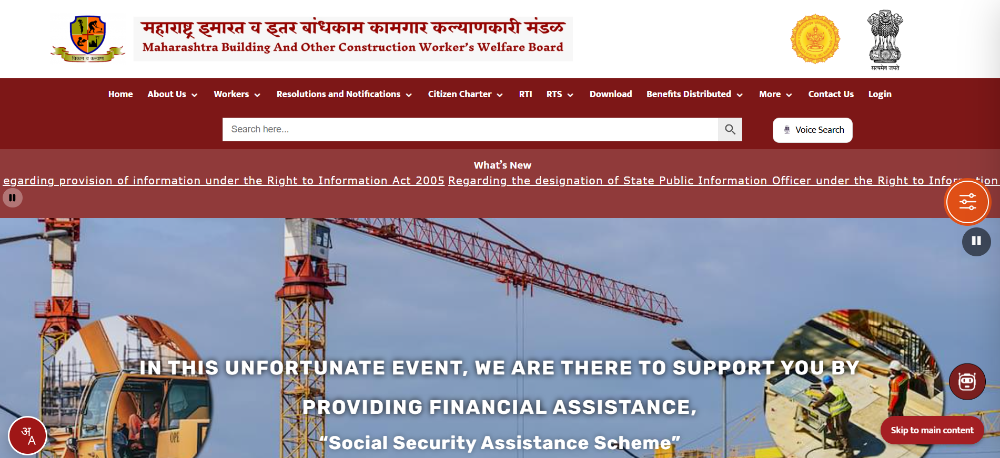
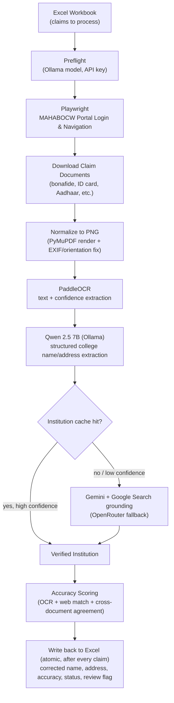

# MAHABOCW Workers Scheme Verification Automation

**Project type:** Intelligent Document Processing (IDP) + browser automation
**Language:** Python
**Target users:** Maharashtra Building & Other Construction Workers Welfare Board (MAHABOCW) verification team
**Status:** Active development

[](https://iwbms.mahabocw.in/sso)

## 1. Purpose

MAHABOCW medical scholarship applicants often enter incomplete, misspelled, or inconsistent college names and addresses in the portal. Verifying each claim by hand — opening documents, reading certificates, and correcting the tracking workbook — is slow and error-prone.

This project automates that verification. It logs into the MAHABOCW portal, pulls each claim's supporting documents, reads them with OCR, extracts structured college details with a local LLM, confirms the institution against the web with Gemini, and writes the corrected, confidence-scored results back to Excel.

For the full technical breakdown, see [`docs/ARCHITECTURE.md`](./docs/ARCHITECTURE.md).

## 2. How It Works



The pipeline runs in two document phases per claim: **Phase 1** (bonafide certificate, college ID) first, and **Phase 2** (Aadhaar, ration card, self-declarations) only if Phase 1 doesn't yield a satisfactory result. Every accepted institution match is cached locally so repeat lookups skip the OCR/LLM/search round-trip.

## 3. Repository Layout

| Path                    | Purpose                                                                                           |
| ----------------------- | ------------------------------------------------------------------------------------------------- |
| `verify_colleges.py`    | Main orchestration script — Excel I/O, browser automation, phase control, output writes, events.  |
| `scoring.py`            | Accuracy score (OCR confidence + web match + cross-document agreement).                           |
| `document_processor.py` | Converts PDFs/images to normalized PNG pages; hashing and orientation correction.                 |
| `ocr_engine.py`         | PaddleOCR initialization and `ocr_image()`.                                                       |
| `extractor.py`          | Ollama/Qwen-based document classification and college detail extraction.                         |
| `web_resolver.py`       | Institution resolution via cache, Gemini search grounding, and OpenRouter fallback.               |
| `logger_config.py`      | Logging setup and the `@@MAHABOCW` event stream the desktop app reads.                            |
| `gui/`                  | Desktop app (pywebview + React/Tailwind) and the installer build.                                 |
| `tests/`                | pytest suite (pure pipeline helpers, scoring, GUI runner/settings).                               |

## 4. Setup & Usage

> **Quick start:** download **`MAHABOCW-Setup.exe`** from the Releases section and run it. It installs the app, its own Python runtime, the pipeline and the Chromium browser — no separate Python install is needed. On first launch, the app's **System check** walks you through installing Ollama and downloading the AI model. See [`docs/SETUP_INSTRUCTIONS.md`](./docs/SETUP_INSTRUCTIONS.md).

### Developer setup (pipeline) — Python 3.12

```powershell
py -3.12 -m venv venv
.\venv\Scripts\Activate.ps1
pip install -r requirements-lock.txt
pip install --no-deps -r requirements-paddle-cpu.txt   # or requirements-paddle-gpu.txt
playwright install chromium
ollama pull qwen2.5:7b-instruct
```

Paddle must be installed with `--no-deps` (its Windows protobuf pin conflicts with `google-genai`; see `requirements-lock.txt`).

Create a `.env` with `GEMINI_API_KEY=...` (optionally `OPENROUTER_API_KEY=...`), `MAHABOCW_INPUT_FILE`, `MAHABOCW_SHEET_NAME`, `MAHABOCW_OUTPUT_FILE` and `EXCEL_PROCESS_ALL=true`, then run `python verify_colleges.py`. Log into the portal in the browser that opens, open Claims, then press Enter in the terminal.

Tests: `pip install pytest` then `python -m pytest tests`.

### Developer setup (desktop app)

```powershell
pip install -r gui\requirements.txt
cd gui\frontend; npm ci; npm run build; cd ..
python -m app.main            # set MAHABOCW_GUI_DEV=1 to use the Vite dev server instead
```

To build the installer: `powershell -ExecutionPolicy Bypass -File gui\packaging\build.ps1 -Python <python with gui requirements>`. See the [GUI developer guide](./gui/README.md).

---

See [`docs/ARCHITECTURE.md`](./docs/ARCHITECTURE.md) for the full technical design, and [`AGENTS.md`](./AGENTS.md) if you're an AI coding assistant working in this repo.
