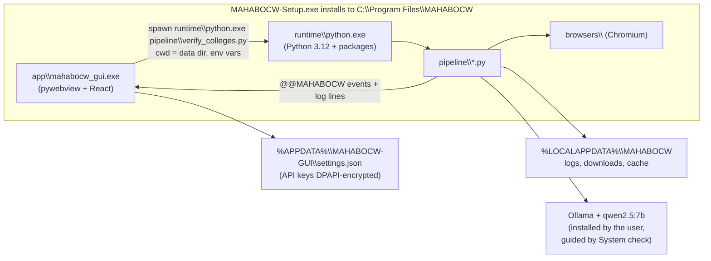

# Architecture

This is the authoritative description of the MAHABOCW verification system: the verification **pipeline** (Part A) and the **desktop app and installer** that run it (Part B). Keep it in sync with the code (see the rule at the end and in `AGENTS.md`).

---

# Part A — Verification pipeline

## A1. Overview

The pipeline turns a workbook of scholarship claims into a verified, scored, corrected workbook. It combines:

- **Browser automation** (Playwright) to pull claim documents out of a government portal that has no API.
- **OCR** (PaddleOCR) to turn scanned certificates into text.
- **A local LLM** (Qwen 2.5 7B via Ollama) to turn noisy OCR text into structured fields.
- **A cloud LLM with web grounding** (Gemini + Google Search; OpenRouter fallback) to resolve the extracted institution to one canonical record.
- **Deterministic scoring** to decide which rows still need a human to look at them.

```mermaid
flowchart TD
    A["Excel workbook<br/>(all rows or a range)"] --> P{"Preflight:<br/>Ollama + model, Gemini key"}
    P -- fails --> X["Exit code 2<br/>(event: preflight_failed)"]
    P -- ok --> B1

    subgraph "Stage 1 · Portal navigation"
        B1["Playwright launches Chromium (visible)"]
        B2["Manual login + captcha + AG Grid setup"]
        B3["Filter grid by acknowledgement_no"]
        B3a{"Every grid row shows<br/>this ack number?"}
        B4["Open claim form, parse links (absolute URLs)"]
        B1 --> B2 --> B3 --> B3a
        B3a -- yes --> B4
        B3a -- "no (20 s)" --> E1["Row status ERROR"]
    end

    subgraph "Stage 2 · Phased documents"
        C1["Phase 1: bonafide + college_id"]
        C2{"Satisfactory?"}
        C3["Phase 2: aadhaar, ration,<br/>self declarations"]
        C1 --> C2
        C2 -- no --> C3
    end

    subgraph "Stage 3 · Normalization"
        D1["Download (60 s timeout, retry) + SHA-256 dedupe<br/>type from magic bytes"]
        D2["PDF → PNG @300 DPI / image → RGB PNG<br/>EXIF fix, ≤3000 px"]
        D3["Rotation: OCR at 0°; 4-angle sweep only<br/>if 0° is not confident"]
        D1 --> D2 --> D3
    end

    E["Stage 4 · PaddleOCR per page"]
    F["Stage 5 · Qwen 2.5 7B (JSON mode)"]

    subgraph "Stage 6 · Institution resolution"
        G2{"Cache match ≥ 90<br/>+ city check?"}
        G3["Gemini + google_search<br/>(models the API serves, in order)"]
        G3v{"verified=false?"}
        G4["OpenRouter fallback"]
        G5{"Confidence ≥ 75?"}
        G6["Accept + atomic cache write"]
        G7["Fallback: OCR values,<br/>resolution_failed"]
        G2 -- no --> G3 --> G3v
        G3v -- yes --> G7
        G3v -- "errors on all models" --> G4 --> G5
        G3v -- answer --> G5
        G5 -- yes --> G6
        G5 -- no --> G7
    end

    subgraph "Stage 7 · Scoring & output"
        H1["accuracy 0-100<br/>(OCR 30 + web 40 + agreement 30)"]
        H2["status VERIFIED / FAILED / NO_DOCS / ERROR<br/>manual_review"]
        H3["Atomic Excel save after every claim"]
        H1 --> H2 --> H3
    end

    B4 --> C1
    C1 --> D1
    C3 --> D1
    D3 --> E --> F --> G2
    G2 -- yes --> H1
    G6 --> H1
    G7 --> H1
```

## A2. Stage-by-stage detail

### Preflight
**File:** `verify_colleges.py` (`preflight()`), `extractor.py` (`check_ollama_ready()`)

Before loading PaddleOCR or opening the browser, the pipeline checks that the Ollama server answers, that `qwen2.5:7b-instruct` is pulled, and that `GEMINI_API_KEY` is set. If Chromium cannot launch, the same failure path applies. On any failure the pipeline logs each problem, emits a `preflight_failed` event and exits with code 2. Without this check, every claim would silently fail extraction and be flagged for review.

The pipeline also refuses to start when the output path equals the input path, because the input would be overwritten with a single sheet.

### Stage 1 — Claim navigation and document discovery
**File:** `verify_colleges.py`

- Launches Chromium (Playwright) **non-headless** so a human can complete login and captcha. Manual login stays manual by design.
- Opens `https://iwbms.mahabocw.in/sso`, emits `awaiting_login`, and blocks on `input()` until the operator has opened Claims and left the Acknowledgement Number filter box open.
- Acknowledgement numbers are read as **text** (`dtype=str`; a trailing `.0` is normalized away) so numeric IDs are never turned into floats.
- For each row: types the ack number into the filter, clicks Apply, then **waits until every rendered grid row contains that ack number as a whole token** (`wait_for_filtered_grid`, up to 20 s). This replaced a fixed 3 s sleep, which could open the *previous* claim's form when the grid was slow and attribute its documents to the wrong row. If the grid never settles, the row is marked `ERROR` and skipped.
- Opens "View claim form" in a new tab, which is closed in a `finally` block even on errors. If the ack number is not visible in the form HTML, a warning is logged. The filtered-grid check is the actual guard.
- Parses labels with BeautifulSoup and resolves links with `urljoin`, collecting the Bonafide Certificate, College Identity Card, Aadhaar Card, Ration Card, Self Declaration and Education Self Declaration.
- Row selection comes from the GUI through environment variables: `EXCEL_PROCESS_ALL`, or `EXCEL_START_ROW` / `EXCEL_END_ROW`. These are Excel row numbers, where row 2 is the first data row.

### Stage 2 — Priority/fallback document processing
**Files:** `verify_colleges.py`, `document_processor.py`

| Phase | Documents | Purpose |
| --- | --- | --- |
| Phase 1 | `bonafide`, `college_id` | Fast path — the most reliable evidence of the institution. |
| Phase 2 | `aadhaar`, `ration`, `self_declaration`, `education_self_declaration` | Fallback, only when Phase 1 gives no satisfactory name + address. Phase 1 pages are not re-OCR'd. |

**Downloads:**
- Use `urlopen` with a 60 s timeout and 3 attempts (2 s / 4 s backoff).
- The file type comes from magic bytes (`sniff_extension`) because portal URLs do not reliably carry one.
- A SHA-256 hash skips duplicate uploads within a claim.

### Stage 3 — Normalization and orientation
**File:** `document_processor.py`

- **PDFs** are rendered at 300 DPI with PyMuPDF.
- **Images** go through `exif_transpose` *before* being saved as PNG, because PNG output drops the EXIF tag. They are then converted to RGB (CMYK and palette images otherwise fail) and capped at 3000 px on the longest side.
- **Rotation:** the page is OCR'd at 0° on a downscaled probe (≤1600 px). If that pass is confident (`avg_conf ≥ 0.85` and `≥ 5` lines), the sweep stops. Otherwise 90°, 180° and 270° are also tried, and the best average confidence wins, with line count as the tiebreaker. Most upright pages therefore cost one probe instead of four.

### Stage 4 — OCR
**File:** `ocr_engine.py`

- PaddleOCR is initialized once, globally, with `use_angle_cls=True`.
- **GPU is used only when** Paddle is CUDA-compiled **and** `paddle.device.cuda.device_count() > 0`. The GPU build therefore falls back to CPU on machines without an NVIDIA GPU instead of crashing.
- NVIDIA `bin` folders from pip packages are added to the DLL search path.
- `ocr_image()` returns `text`, `avg_confidence`, `min_confidence`, `high_conf_ratio` and `line_count`.

### Stage 5 — Local LLM extraction
**File:** `extractor.py`

- `qwen2.5:7b-instruct` through Ollama, called with `format="json"` (constrained JSON output), `temperature=0` and `num_ctx=8192`. The system prompt alone is about 2k tokens, so smaller default contexts would truncate it.
- The prompt classifies the page (bonafide / student ID / irrelevant), corrects common OCR errors, and separates managing trusts from the college name.
- `parse_llm_json()` tolerates code fences and stray text.
- `is_satisfactory()` requires a relevant result with both `college_name` and `college_address`. This gates Phase 2.

### Stage 6 — Online institution resolution
**File:** `web_resolver.py`

1. `clean_address()` strips phone, fax, email and website noise, duplicate PINs and punctuation.
2. `_find_cache_record()` fuzzy-matches the name against `institution_cache.json`, which lives in the working directory. A hit needs a score of at least `CACHE_HIT_THRESHOLD = 90` **and** a cached city compatible with the OCR address. A hit returns `match_confidence = 100` and `via_cache = True`, with no API calls.
3. On a miss, `GeminiResolver.resolve()` calls Gemini with the native `google_search` tool, using the models in `GEMINI_MODELS`, in order:
   - `gemini-2.5-flash-lite`
   - `gemini-2.5-flash`
   - `gemini-3-flash`
   - `gemini-3.1-flash-lite`
   - `gemini-3.5-flash`

   On first use the list is filtered against `client.models.list()`, so IDs the API does not serve are skipped with a warning. If listing fails, the configured list is used as-is.
4. **`verified=false` stops the chain.** When a grounded model says it cannot verify the institution, weaker or ungrounded models are not asked; the row falls back. OpenRouter (`openrouter/auto`, no search grounding) is used only when **every** Gemini call errored (quota, outage, malformed JSON). It requires `OPENROUTER_API_KEY`.
5. `_is_generic_name()` rejects names made up **only** of generic words, such as "Medical College". Short real names like "Government Medical College" are accepted; the city is appended afterwards.
6. Match confidence is the RapidFuzz token-set score between the resolved and extracted names. Below `CONFIDENCE_REJECT_THRESHOLD = 75` the resolver falls back, and it also falls back when the address or city is missing.
7. On success the record (name with city appended, address, city, aliases) is written to the cache **atomically** (temp file + `os.replace`). A corrupt cache file is moved aside to `institution_cache.json.corrupt-<time>` instead of being silently overwritten.

### Stage 7 — Scoring and Excel output
**Files:** `scoring.py` (`compute_accuracy()`), `verify_colleges.py` (`write_result()`)

| Component | Max | Logic |
| --- | ---: | --- |
| OCR confidence | 30 | `round(mean avg_confidence × 30)` over **relevant** pages. Falls back to all pages with text when none was relevant. |
| Web verification | 40 | `round(match_confidence / 100 × 40)` when resolution succeeded (cache hit = 40); 0 when it failed. |
| Cross-document agreement | 30 | Counts **distinct** relevant documents, so a 2-page bonafide counts once. ≥ 2 documents whose extracted names agree (token-set ≥ 85) → 30; exactly 1 relevant document, or only one with a name → 15; ≥ 2 that **disagree** → 0, because conflicting certificates are a red flag; none → 0. |

**Output columns:**
- `corrected_college_name` and `corrected_college_address` (upper-cased),
- `accuracy`,
- `manual_review`: `YES` when accuracy < `ACCURACY_THRESHOLD = 80` or the status is not `VERIFIED`,
- `online_verification_status`:

  | Status | Meaning | Retried on the next run? |
  | --- | --- | --- |
  | `VERIFIED` | Web resolution succeeded | No |
  | `FAILED` | Documents read, resolution failed | Only with `MAHABOCW_RETRY_FAILED` |
  | `NO_DOCS` | No usable bonafide or ID | Only with `MAHABOCW_RETRY_FAILED` |
  | `ERROR` | Portal or processing error | Always |

**Saving and resuming:**
- The output workbook is written **after every claim**, atomically (`<name>.saving.xlsx` then `os.replace`), so a forced stop or crash can never corrupt it. The write is retried every 5 s while the file is open in Excel.
- On the next run, an existing output file is read instead of the input. Rows with a final status, or a filled `corrected_college_name` from older versions, are skipped (resumable).
- Only the selected sheet is written to the output workbook.

**Stopping and clean-up:**
- **Graceful stop:** the pipeline checks the file named by `MAHABOCW_STOP_FILE` between claims. When the file exists, it saves and exits with code 0.
- **PII clean-up:** when `MAHABOCW_DELETE_DOWNLOADS=true`, each claim's `downloads/<ack>/` folder is deleted after the claim is saved.

### Structured events (stdout)
**File:** `logger_config.py` (`emit_event()`)

Alongside the human-readable log, the pipeline prints one-line JSON events prefixed with `@@MAHABOCW `. The GUI consumes these events and hides them from the log.

| Event | Fields |
| --- | --- |
| `preflight_failed` | `problems[]` |
| `awaiting_login` | — |
| `run_start` | `total` |
| `claim_start` | `n`, `total`, `ack` |
| `claim_step` | `step` (finding claim, downloading, reading documents, verifying, …) |
| `claim_skipped` | `n`, `total`, `ack`, `reason` |
| `claim_done` | `n`, `total`, `ack`, `status`, `accuracy`, `manual_review`, `college`, `via_cache` |
| `run_end` | `stopped`, `total`, `output_file`, `summary` (`VERIFIED`, `FAILED`, `NO_DOCS`, `ERROR`, `skipped`, `manual_review`, `cache_hits`, `processed`) |

tqdm progress bars are disabled when stdout is not a terminal, so they cannot flood the GUI log.

## A3. Configuration (environment variables)

| Variable | Purpose |
| --- | --- |
| `MAHABOCW_INPUT_FILE`, `MAHABOCW_SHEET_NAME`, `MAHABOCW_OUTPUT_FILE` | Workbook paths and sheet (required) |
| `EXCEL_PROCESS_ALL` / `EXCEL_START_ROW`, `EXCEL_END_ROW` | Row selection |
| `GEMINI_API_KEY` | Required |
| `OPENROUTER_API_KEY` | Optional fallback |
| `MAHABOCW_STOP_FILE` | Graceful-stop flag file |
| `MAHABOCW_DELETE_DOWNLOADS` | Delete claim documents after each claim |
| `MAHABOCW_RETRY_FAILED` | Re-run `FAILED` / `NO_DOCS` rows |
| `PLAYWRIGHT_BROWSERS_PATH` | Chromium location (set by the GUI to the installer's `browsers\`) |

For command-line use, these can be placed in a `.env` file (loaded with `python-dotenv`). Never commit it.

Relative paths (`downloads/`, `logs/`, `institution_cache.json`) resolve against the **working directory**. The GUI uses `%LOCALAPPDATA%\MAHABOCW`.

## A4. Dependencies

- **`requirements-lock.txt`** holds the shared pipeline dependencies. Paddle is installed separately with `--no-deps`, from `requirements-paddle-cpu.txt` or `requirements-paddle-gpu.txt`. Reason: `paddlepaddle==2.6.2` pins `protobuf<=3.20.2` on Windows while `google-genai` needs protobuf 5, so a single `pip -r` cannot resolve. At runtime the clash is avoided with `PROTOCOL_BUFFERS_PYTHON_IMPLEMENTATION=python`, set at the very top of `verify_colleges.py`.
- **Python 3.12 only:** Paddle 2.6.2 and numpy 1.26 have no 3.13 wheels.

## A5. Known constraints

- Semi-automated by design: portal login and captcha stay manual.
- Portal automation depends on the current MAHABOCW UI and AG Grid markup. A portal change can break Stage 1, and the grid check then marks rows `ERROR` instead of processing the wrong claim.
- The Gemini model IDs above are filtered at runtime; keep the list current as Google retires models.

---

# Part B — Desktop app and installer

## B1. Overview

The desktop app (`gui/`) is a pywebview window rendering a React/Tailwind SPA through the Windows Edge **WebView2** runtime. It never imports the pipeline. It launches `verify_colleges.py` as a subprocess, using the installer's private Python, and talks to it through environment variables, stdin (the login confirmation), the stop file and the stdout event stream.

## B2. Files

| File | Responsibility |
| --- | --- |
| `gui/app/main.py` | pywebview entry point. Creates the window, close guard (force-stops a live run after confirmation). pywebview serves the bundled `frontend_dist/` over its built-in local HTTP server. |
| `gui/app/api.py` | `Api`: the only JS bridge surface (table below). |
| `gui/app/runner.py` | `PipelineRunner`: subprocess, event parsing, batched log push, pause/resume, graceful and force stop. |
| `gui/app/settings.py` | `Settings` dataclass + JSON persistence (DPAPI for keys), install-layout detection, data dir, env var mapping. |
| `gui/frontend/src/` | React app: `App.jsx` (screen state machine), `components/{Splash,Settings,Run,Done,ui}.jsx`, `lib/bridge.js`, `lib/format.js`, `index.css`. |
| `gui/packaging/` | `mahabocw_gui.spec` (PyInstaller), `mahabocw_setup.iss` (Inno Setup), `setup_runtime.cmd`, `build.ps1`, `version_info.txt`, WebView2 bootstrapper. |

### Install-layout detection (`settings.py`)

When frozen, the install root is the parent of the exe folder, and it counts only if `pipeline\verify_colleges.py` exists there. The defaults derived from it are:

| Value | Default |
| --- | --- |
| Pipeline folder | `{root}\pipeline` |
| Python | `{root}\runtime\python.exe` |
| `PLAYWRIGHT_BROWSERS_PATH` | `{root}\browsers` |

In development (not frozen) the defaults are the repo root and `python`. A stored pipeline folder that no longer contains `verify_colleges.py` (e.g. from the old two-installer layout) is ignored, so detection takes over. The Settings screen offers overrides only under **Advanced**.

## B3. Bridge (`Api`)

| Method | Kind | Description |
| --- | --- | --- |
| `get_initial_state()` | pull | `{settings, environment, running}` |
| `system_check(settings)` | pull | Items for pipeline files, Python packages, Chromium, OCR acceleration (GPU/CPU), Ollama, the Qwen model and the Gemini key. Each item has a status (`ok`/`warn`/`error`) and an optional action (`install_ollama`, `start_ollama`, `pull_model`). Packages, Chromium and GPU are checked by running a short script in the pipeline's Python. |
| `get_sheet_names(path)`, `test_python(exe)` | pull | `test_python` succeeds only on exit code 0 and a "Python x.y" reply. |
| `pick_*()` | dialog | Native file and folder pickers |
| `save_settings(dict)` | command | Persist (keys encrypted) |
| `start_pipeline(dict)` | command | Refuses if a run is already alive. Returns `{ok, total_rows}`. |
| `pause_pipeline()` / `resume_pipeline()` | command | psutil suspend / resume |
| `stop_pipeline()` | command | Graceful: writes the stop file. Before the claim loop has started, it force-stops instead. |
| `force_stop_pipeline()` | command | Terminate the process tree, then kill survivors after 5 s |
| `confirm_login()` | command | Sends a newline to the pipeline's stdin |
| `open_file`, `open_log`, `open_folder(which)`, `open_url`, `install_ollama`, `start_ollama` | command | Shell helpers. `open_url` only opens allow-listed URLs. |
| `pull_model()` | command | Streams Ollama `/api/pull` progress as `model-pull` events |

### Push events

Push events are sent as JSON → UTF-8 → base64, then `evaluate_js` dispatches a `CustomEvent`. The JS side decodes with `TextDecoder`, so Devanagari text survives.

| Event | Payload |
| --- | --- |
| `pipeline-log` | `{lines: [...]}`, batched every ~100 ms |
| `pipeline-event` | Any pipeline event from §A2 |
| `pipeline-progress` | `{count, total}`. Counts skipped and done rows, so resumed runs reach 100%. |
| `pipeline-awaiting-login` | `{}` |
| `pipeline-done` | `{claims_seen, output_file, summary, stopped}` |
| `pipeline-error` | `{message}`: non-zero exit, preflight problems, force stop, or launch failure |
| `model-pull` | `{status, completed, total, done, error?}` |

The runner reads stdout line by line; the pipeline emits `awaiting_login` (with a newline) before it blocks on `input()`. The `input()` prompt itself has no trailing newline, so the next event arrives glued to it. The runner splits such lines at the `@@MAHABOCW ` prefix. The GUI and pipeline always ship together, so there is no fallback for pipelines that do not emit events.

## B4. Screens

The flow is Splash → Settings → Run → Done.

- **Settings:**
  - the System check card, with inline fixes and a model download progress bar;
  - files, with input ≠ output validation;
  - API keys (Gemini required, OpenRouter optional);
  - row range plus options (delete downloaded documents, default on; retry failed claims);
  - Advanced overrides.

  Inline per-field validation runs on every field. "Save & start" stays disabled while the System check reports an error.
- **Run:**
  - a login banner with numbered steps;
  - stat tiles (rows done, verified, need review, failed, already done, time left);
  - the current claim and step;
  - a colour-coded log, capped at 5,000 lines and appended once per animation frame;
  - Pause/Resume;
  - a Stop dialog (stop after the current claim, or force stop).

  Navigation is disabled while a run is active.
- **Done:** a summary from `run_end`, a notice of how many rows need review, buttons to open the results, the log and the downloads folder, and Run again / Change settings.

Fonts (Inter via `@fontsource`) and icons (`lucide-react`) are bundled, so the UI makes no network requests.

## B5. Build and packaging

`gui/packaging/build.ps1` runs the whole build:

1. `npm ci && npm run build`. Vite writes directly to `gui/frontend_dist/` (`build.outDir`), the folder PyInstaller bundles. `frontend_dist/` is gitignored.
2. **Stale-UI guard:** the build fails if `frontend_dist/index.html` is older than any file in `frontend/src`, `frontend/public` or `frontend/index.html`.
3. `pyinstaller packaging/mahabocw_gui.spec` (onedir, windowed) produces `gui/dist/mahabocw_gui/`.
4. Downloads the pinned python-build-standalone CPython 3.12 (`install_only`) archive, verifies it against the release's `SHA256SUMS`, and extracts it to `gui/packaging/build/runtime/`.
5. Compiles `mahabocw_setup.iss` with Inno Setup 6 (ISCC) into `gui/packaging/Output/MAHABOCW-Setup.exe`.

### Installer (`MAHABOCW-Setup.exe`)

- **Admin install** to `{autopf}\MAHABOCW`. A wizard page offers CPU (default) or NVIDIA GPU.
- **Migration:** if the old "MAHABOCW Pipeline" or "MAHABOCW Verification Tool" installs are present, they are uninstalled first (with consent).
- **Post-install steps:**
  1. Runs the WebView2 bootstrapper.
  2. Runs `tools\setup_runtime.cmd <cpu|gpu>`, which performs, in order:
     - `pip install -r requirements-lock.txt`,
     - `pip install --no-deps -r requirements-paddle-<mode>.txt`,
     - `playwright install chromium` into `{app}\browsers`,
     - an import check, and finally writes `.setup_complete`.

  Every step's exit code is checked and logged to `{app}\install.log`. On failure the installer names the failed step and points to the log and to the Start-menu "Repair MAHABOCW components" shortcut, which re-runs the script.
- **Uninstall** removes `runtime\`, `browsers\`, `install.log` and the marker, so no packages are left behind. Per-user data in `%LOCALAPPDATA%\MAHABOCW` is kept.
- **Not installed:** Ollama and the Qwen model are left to the user. The System check detects them and offers to download Ollama, start it, or pull the model.

## B6. Security and privacy

- API keys are stored DPAPI-encrypted, bound to the Windows user. They reach the pipeline only through environment variables.
- Claim documents (Aadhaar and ration cards) are deleted after each claim by default. The working folder is per-user, not in a shared system folder.
- The GUI itself loads only bundled local files. All network access happens in the pipeline (portal, Gemini, OpenRouter, Ollama on localhost) and in the System check (Ollama on localhost, model download).

---

## Keeping this document current

**Update this file in the same change as any change to:**
- pipeline stages or file responsibilities,
- scoring logic,
- model or provider fallback chains,
- thresholds,
- the event protocol or bridge API,
- packaging,
- data flow.

See `AGENTS.md`. A change that makes a paragraph or diagram here wrong is incomplete until this file is fixed.
